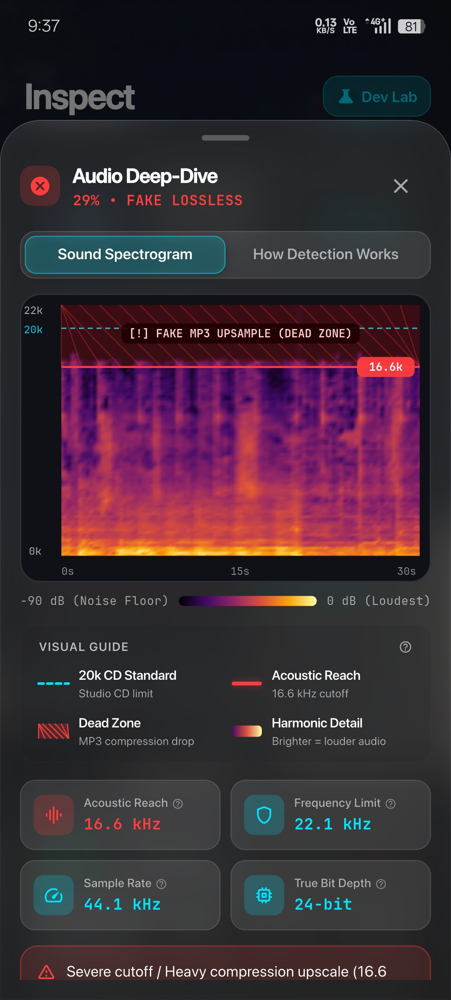
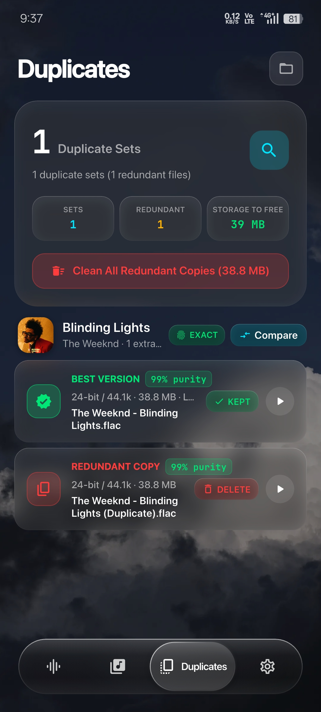
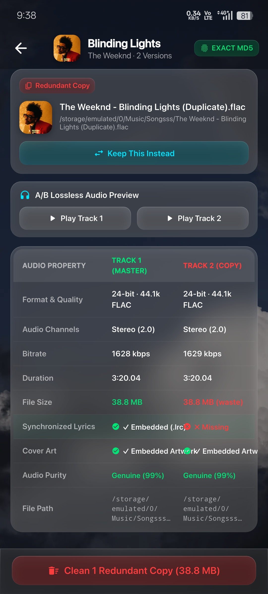

<div align="center">


# AcoustiQ

**Studio-grade FLAC forensic inspector for Android.**

Verify lossless authenticity · Detect fake re-encodes · Resolve smart duplicates

<br />

[](https://flutter.dev)
[](https://dart.dev)
[](https://developer.android.com)
[](#)
[](#license)
[](#privacy)

<br />

[Features](#features) · [Screenshots](#screenshots) · [Get Started](#get-started) · [Architecture](#architecture) · [Privacy](#privacy) · [License](#license)

</div>

<br />

## Why AcoustiQ?

Your FLAC files might not be what they claim. Low-bitrate MP3s re-encoded into FLAC containers are indistinguishable by filename or metadata alone. AcoustiQ performs real-time spectral analysis and MD5 audio stream verification to separate genuine studio masters from imposters — then helps you clean up duplicates without losing the best version.

<br />

## Features

<table>
  <tr>
    <td width="50%">
      <h3>🔬 Forensic Inspector</h3>
      <ul>
        <li>Bilinear Inferno spectrogram visualization</li>
        <li>High-frequency roll-off detection (16–22+ kHz)</li>
        <li>Spots fake FLAC re-encodes instantly</li>
        <li>Full bitstream telemetry: sample rate, bit depth, channels, bitrate</li>
      </ul>
    </td>
    <td width="50%">
      <h3>🛡️ MD5 Integrity Verification</h3>
      <ul>
        <li>Verifies audio against FLAC STREAMINFO MD5 hash</li>
        <li>Detects bit-rot, corruption, and incomplete transfers</li>
        <li>One-tap lossless export of cover art and synced lyrics</li>
      </ul>
    </td>
  </tr>
  <tr>
    <td width="50%">
      <h3>🎯 Smart Duplicate Resolver</h3>
      <ul>
        <li>Multi-vector duplicate detection (hash, metadata, filename)</li>
        <li>Side-by-side forensic comparison with spec diff</li>
        <li>AcoustiQ Pick: auto-recommends the best version to keep</li>
        <li>A/B lossless audio preview with inline seek</li>
      </ul>
    </td>
    <td width="50%">
      <h3>📊 Audit & Reports</h3>
      <ul>
        <li>Library-wide batch quality scanner</li>
        <li>Quarantine vault with restore lifecycle</li>
        <li>CSV & JSON forensic audit export</li>
      </ul>
    </td>
  </tr>
</table>

### Also packed with

- **120 FPS Liquid Lens Navigation Dock** — Sub-stepped Euler physics engine at 240 Hz, kinematic squash & stretch, frosted glass optical blur
- **Hardware-Tiered Rendering** — Auto-detects device capability, toggles low-power mode for older hardware
- **4 Curated Typography Fonts** — SF Pro, Geist, Plus Jakarta Sans, Inter
- **Photographic Wallpaper Collection** — Handpicked studio-aesthetic backgrounds
- **Responsive Layouts** — Adaptive phone (stacked cards) and tablet (side-by-side) comparison views

<br />

## Screenshots

<div align="center">

| 🔬 Forensic Inspector | 📊 STFT Spectrogram & Dead Zone | 📈 Library Audit & Health |
| :---: | :---: | :---: |
|  |  |  |
| **24-bit Studio Master FLAC** | **16.6 kHz MP3 Upscale Dead-Zone** | **Batch verification & health ratio** |

<br />

| 🎯 Smart Duplicates Resolver | 📱 Encapsulated Comparison Sheet | 🖥️ Full Forensic Matrix |
| :---: | :---: | :---: |
|  |  |  |
| **Bit-identical match detection** | **Side-by-side spec comparison** | **A/B playback & delta metrics** |

<br />

| ⚙️ System, Glass & Update Hub |
| :---: |
|  |
| **WWDC25 Frosted Glass & In-App GitHub Releases** |

</div>

<br />

## Get Started

### Prerequisites

| Tool | Version |
|------|---------|
| Flutter | 3.50.0+ |
| Dart | 3.14.0+ |
| Android SDK | 36 |
| JDK | 17 |
| Kotlin | 2.2.20 |
| Gradle | 9.3.1 |

### Build & Run

```bash
# Clone
git clone https://github.com/NONDEADER/acoustiq.git
cd acoustiq

# Install dependencies
flutter pub get

# Run on connected device
flutter run

# Or build release APK
flutter build apk --release
```

### Wireless Deploy (Recommended)

```bash
adb connect <DEVICE_IP>:5555
./deploy.sh
```

The deploy script compiles a release APK and installs it over wireless ADB in ~20 seconds.

<br />

## Architecture

```
lib/
├── main.dart                        # App bootstrap
├── models/                          # Data models (AppSettings, FlacInfo)
├── screens/
│   ├── inspect_screen.dart          # Forensic inspector & spectrogram
│   ├── audit_screen.dart            # Library-wide batch scanner
│   ├── duplicates_screen.dart       # Duplicate resolver & comparison
│   ├── settings_screen.dart         # Appearance, engine & cache
│   └── splash_screen.dart           # Launch branding
├── services/
│   ├── flac_parser.dart             # FLAC metadata & Vorbis tag parser
│   ├── audio_dsp.dart               # FFT & roll-off analysis
│   ├── audio_playback_service.dart  # Android MediaPlayer bridge
│   └── duplicate_detector.dart      # Multi-vector duplicate engine
└── widgets/
    ├── liquid_lens_dock.dart        # 120 FPS physics navigation
    ├── audio_spectrum_stage.dart    # Spectrogram visualizer
    ├── glass_card.dart              # Frosted glass UI surfaces
    └── ...
```

### Tech Stack

| Layer | Technology |
|-------|-----------|
| Framework | Flutter 3.50.0 / Dart 3.14.0 |
| Native Bridge | Kotlin 2.2.20 (MediaCodec, StorageStatsManager) |
| Build System | Gradle 9.3.1 / AGP 9.1.1 |
| Target | Android API 21–36 |
| Audio DSP | Custom FFT with bilinear interpolation |
| Physics Engine | Sub-stepped semi-implicit Euler (240 Hz) |

<br />

## Privacy & Security

AcoustiQ audio processing and forensic algorithms are **100% offline and private**. Audio samples, hashes, and metadata never leave your phone. Optional network access is exclusively reserved for transparent user-initiated GitHub update checks (`api.github.com/repos/NONDEADER/acoustiq`). Zero analytics, zero ad tracking, zero telemetry.

<br />

## License

This project is licensed under the MIT License — see the [LICENSE](LICENSE) file for details.

<br />

<div align="center">

---

Built by [NONDEADER](https://github.com/NONDEADER)

</div>
