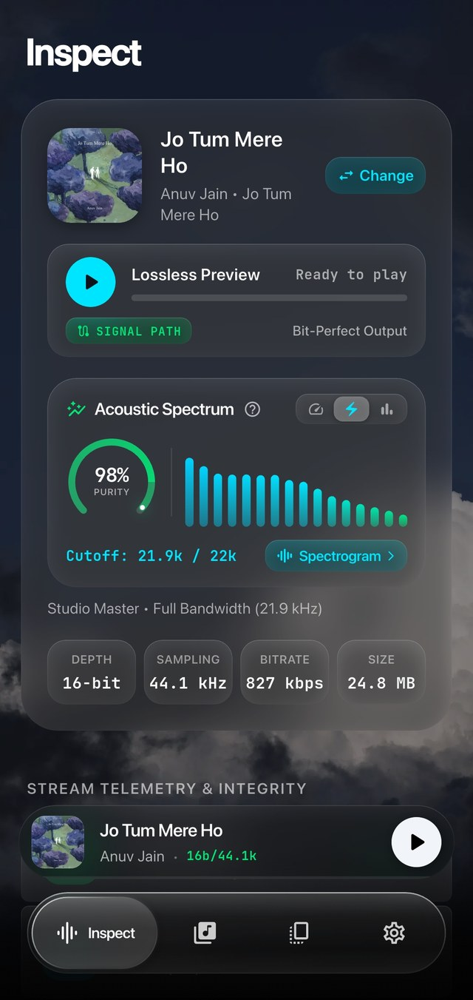
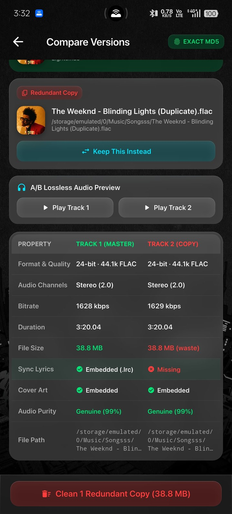
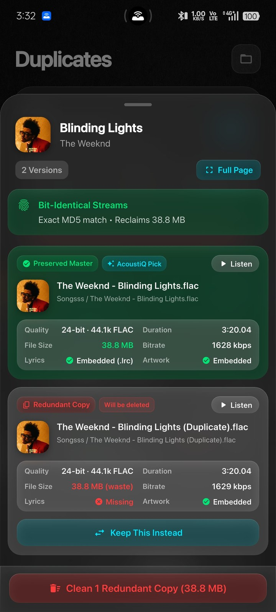

<div align="center">


# AcoustiQ

**Spot fake "Hi-Res" FLACs, clean up duplicate tracks, and listen with live synced lyrics & USB DAC pass-through — 100% offline on Android.**

<p>
  <a href="https://github.com/Clash-Projects/acoustiq/releases/latest">
    
  </a>
  <a href="https://github.com/Clash-Projects/acoustiq/releases">
    
  </a>
  
  <a href="https://github.com/Clash-Projects/acoustiq/blob/main/LICENSE">
    
  </a>
</p>

<p>
  <a href="https://github.com/Clash-Projects/acoustiq/releases/latest">
    
  </a>
  &nbsp;
  <a href="https://discord.gg/DmyM2p2fMe">
    
  </a>
</p>

<p>
  <a href="#screenshots">Screenshots</a> ·
  <a href="#features">Features</a> ·
  <a href="#download--install">Download</a> ·
  <a href="#permissions--privacy">Privacy</a> ·
  <a href="#faq">FAQ</a> ·
  <a href="#under-the-hood--build">Build from Source</a>
</p>

</div>

---

## Why AcoustiQ?

Because renaming a 128 kbps MP3 to `.flac` shouldn't fool anyone — not even your music player.

Low-bitrate files dressed up in lossless containers look identical in normal apps and file managers. **AcoustiQ** inspects the actual audio frequencies and file checksums right on your phone, exposes upscaled fakes, cleans out redundant copies without touching unique live cuts, and lets you listen through a crisp audiophile player with offline synced lyrics.

## Screenshots

<p align="center">
  
  &nbsp;&nbsp;
  
  &nbsp;&nbsp;
  
</p>

<p align="center">
  <em>Forensic Inspector · Spectrogram Fake Detection · 60fps Synced Lyrics</em>
</p>

<details>
<summary>📸 View More Screens (Library Audit, Duplicate Resolver, Comparison Sheet & Full Player)</summary>
<br />
<p align="center">
  
  &nbsp;&nbsp;
  
  &nbsp;&nbsp;
  
</p>
<p align="center">
  
  &nbsp;&nbsp;
  
</p>
</details>

## Features

- **🔬 Catch Upscaled Fakes Instantly** — Visualizes high-frequency cutoffs with heat-map spectrograms so transcoded MP3s pretending to be studio masters can't hide.
- **🛡️ Verify File Integrity** — Audits your entire music folder against embedded audio checksums to spot corruption, truncated transfers, and bit-rot.
- **🧹 Smarter Duplicate Cleanup** — Matches identical copies *without* confusing a studio cut for an extended live recording, then lets you audition both by ear before deleting wasted space.
- **⚡ Hi-Res & USB DAC Playback** — Plays crisp 16-bit, 24-bit, and 32-bit audio natively and unlocks direct USB DAC pass-through with an honest Signal Path monitor (celebrates **Bit-Perfect** only when it's genuinely bit-perfect).
- **📝 60fps Offline Synced Lyrics** — Word- and line-synced highlights, tap-to-seek lyrics, right-to-left script support, three visual styles (`Default`, `Flow`, `Halo`), and one-tap cover art / `.lrc` export.
- **🎨 Liquid Glass or Solid Matte** — Switch freely between frosted translucent Liquid Glass and high-contrast, battery-friendly **Matte Mode**, complete with **Monochrome**, 5 accent themes, AMOLED black, and 4 curated fonts.

## Download & Install

1. Grab the latest signed APK from [**GitHub Releases**](https://github.com/Clash-Projects/acoustiq/releases/latest) and install it on **Android 8.0+**.
2. Grant audio/storage access so AcoustiQ can inspect your local music folders.
3. *(Optional)* Verify your download using the `.sha256` file from the same release (`sha256sum -c AcoustiQ-*.apk.sha256`).

> [!IMPORTANT]
> **Upgrading from `v1.0.0`, `v1.1.0`, or older test builds?**
> If Android shows a *"Package conflicts with an existing package"* or *"App not installed"* error, **uninstall the older version first** before installing `v2.0.0+`. Recent builds use AcoustiQ's official release signature and package identity, so Android won't overwrite older legacy signatures automatically.

> [!TIP]
> **Don't own an external USB DAC?** No problem — spectral inspection, duplicate cleanup, synced lyrics, and low-latency native speaker/headphone playback work out of the box with zero extra hardware.

## Permissions & Privacy

AcoustiQ runs **100% offline** — your music, tags, and hashes never leave your phone. Zero analytics, zero ads, zero telemetry.

| Permission | Why It's Needed |
| :--- | :--- |
| **Storage / Audio Files** | Read your local tracks to inspect audio spectra, check file hashes, and clean duplicate copies you approve |
| **USB Host** *(Optional)* | Talk directly to external USB DACs when plugged in for hardware pass-through |
| **Internet** *(Optional)* | Strictly idle in the background — only contacts GitHub when *you* tap **Check for Updates** |

## FAQ

<details>
<summary>❓ Common Questions (Purity Scores, USB DACs, Matte Mode)</summary>

- **Why did my `24-bit / 96 kHz` FLAC score low?**
  A file's container specs don't guarantee its source quality. If someone converted a compressed `16 kHz` MP3 into a `24-bit` FLAC, the upper frequencies are empty dead space — and AcoustiQ flags that shelf cleanly.
- **Why does Signal Path show `AAudio` instead of `Bit-Perfect`?**
  Phone speakers and standard headphone jacks pass through Android's system mixer, which resamples audio. True bit-perfect status appears strictly when an external USB DAC locks onto your track's exact sample rate and bit depth.
- **Does turning off Translucent Glass save battery?**
  Yes — **Matte Mode** disables live backdrop blur shaders across every card and the navigation dock, giving you sharper contrast and lighter GPU load (especially paired with **AMOLED Mode**).

</details>

## Under the Hood & Build

<details>
<summary>🛠️ Technical Engine, Build Commands, Release Signing & Project Structure</summary>

### Technical Audio & DSP Stack
- **Spectral Engine**: Custom Cooley-Tukey FFT & Welch PSD roll-off detector (`audio_dsp.dart`) + bilinear Inferno spectrogram stage (`audio_spectrum_stage.dart`) paired with binary FLAC `STREAMINFO` MD5 validation (`flac_parser.dart`).
- **Native Playback**: Multi-depth PCM decoder (`16-bit`, `24-bit` packed, `32-bit`, `PCM Float`) in `NativeAudioEngine.kt`, kernel USBFS UAC1/UAC2 driver (`usbiso.c`), AAudio / OpenSL ES output (`nativeout.c`), and automatic `MediaPlayer` fallback.

### Prerequisites & Build Commands
- **Flutter** `3.50.0+` / **Dart** `3.14.0+`
- **Android SDK** (Compile 36 / Min 26 / Target 35) · **NDK** `28.2.13676358` · **JDK** `17`

```bash
git clone https://github.com/Clash-Projects/acoustiq.git
cd acoustiq
flutter pub get
flutter analyze --no-fatal-infos
flutter test
flutter build apk --release
```

### Wireless Deploy & Release Signing
- Connect over wireless ADB (`adb connect <DEVICE_IP>:5555`) and run `./deploy.sh`.
- Add gitignored `android/key.properties` + `.jks` locally (or `ANDROID_KEYSTORE_*` GitHub Secrets) for release signing; Gradle falls back cleanly to debug signing if omitted.

### Project Structure

```text
.github/workflows/build.yml        CI verify + signed APK releases
android/app/src/main/
├── cpp/
│   ├── usbiso.c                   USBFS UAC1/UAC2 DAC driver
│   ├── nativeout.c                AAudio & OpenSL ES output
│   └── CMakeLists.txt             16 KB page-size alignment
└── kotlin/com/clashprojects/acoustiq/
    ├── MainActivity.kt            Platform channels & fallback
    └── NativeAudioEngine.kt       PCM decoder & USB handshake
lib/
├── main.dart                      Bootstrap & notifications
├── models/                        Settings, themes & track model
├── screens/                       Inspect, Audit, Duplicates, Player
├── services/                      Parser, FFT DSP, USB & updater
├── utils/                         Synced/plain lyrics parser
└── widgets/                       Euler dock, lyrics, glass & matte
```

</details>

## Contributing & Community

Found a false positive on an edge-case track, spotted a USB DAC quirk, or want to help improve AcoustiQ? [Open an Issue](https://github.com/Clash-Projects/acoustiq/issues) or hang out with us:

- **Discord:** [Join Clash Projects](https://discord.gg/DmyM2p2fMe)
- **Telegram:** [@clashprojects](https://t.me/clashprojects)
- **License:** [GNU General Public License v3.0](LICENSE)

<div align="center">

---

Built with ❤️ by [Clash Projects](https://github.com/Clash-Projects)

</div>
