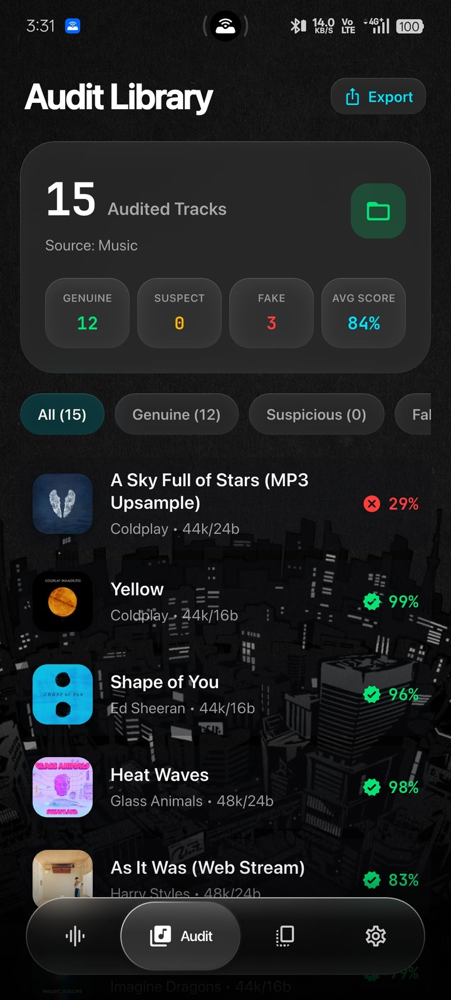
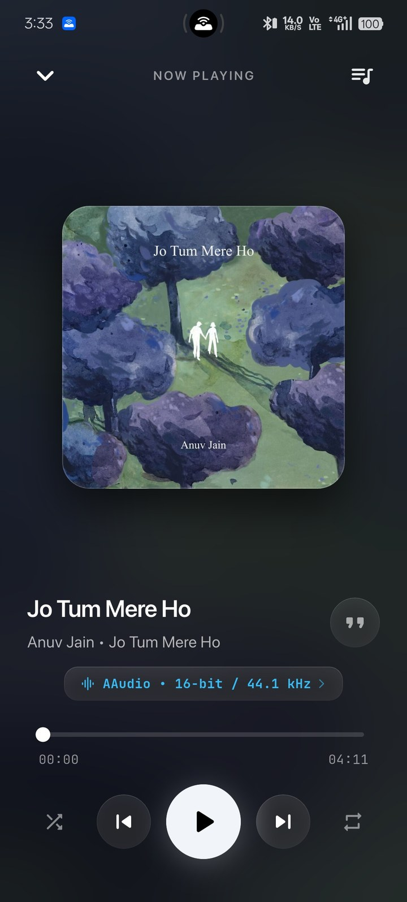
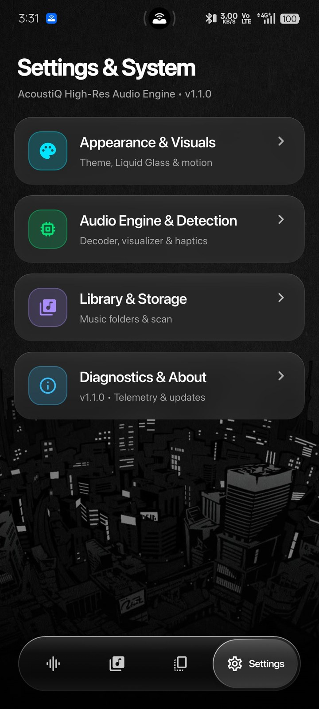

<div align="center">


# AcoustiQ

**Studio-grade lossless FLAC forensic inspector, bit-perfect audio verifier, and audiophile player for Android.**

Verify genuine studio masters · Spot MP3-to-FLAC fakes · Resolve duplicates · Listen with synced lyrics & USB DAC pass-through

<br />

[](https://github.com/Clash-Projects/acoustiq/releases)
[](https://flutter.dev)
[](https://dart.dev)
[](https://developer.android.com)
[](#license)
[](#privacy--security)
[](https://discord.gg/DmyM2p2fMe)

<br />

[Features](#features) · [Screenshots](#screenshots) · [Get Started](#get-started) · [Architecture](#architecture) · [Privacy](#privacy--security) · [Community](#community--support) · [License](#license)

</div>

<br />

## Why AcoustiQ?

A `.flac` extension or `24-bit / 96 kHz` tag doesn't guarantee lossless audio. Lossy MP3/AAC files transcoded into FLAC containers look identical in standard file managers and music players.

AcoustiQ runs **100% offline** forensic analysis right on your phone — pairing binary `STREAMINFO` MD5 validation with Cooley-Tukey FFT & Welch PSD spectral roll-off inspection — alongside a full audiophile playback engine featuring USB UAC1/UAC2 bit-perfect pass-through, offline word/line-synced lyrics, and a smart duplicate resolver.

<br />

## Features

<table>
  <tr>
    <td width="50%">
      <h3>🔬 Forensic Inspector & Spectrogram</h3>
      <ul>
        <li>Bilinear Inferno STFT spectrogram visualization</li>
        <li>Welch PSD high-frequency cutoff detection (16–22+ kHz)</li>
        <li>Instant detection of fake MP3-to-FLAC upscales</li>
        <li>Full binary bitstream telemetry: bit depth, sample rate, MD5, Vorbis comments</li>
      </ul>
    </td>
    <td width="50%">
      <h3>🛡️ Library Audit & MD5 Verification</h3>
      <ul>
        <li>Verifies audio frames against embedded FLAC <code>STREAMINFO</code> MD5</li>
        <li>Detects bit-rot, truncated downloads, and file corruption</li>
        <li>Interactive health breakdown across your entire music library</li>
        <li>One-tap lossless export for album artwork and embedded lyrics</li>
      </ul>
    </td>
  </tr>
  <tr>
    <td width="50%">
      <h3>🎯 Smart Duplicate Resolver</h3>
      <ul>
        <li>Multi-stage matching (exact MD5 hash, metadata, normalized title/artist, duration delta)</li>
        <li>AcoustiQ Pick auto-ranks genuine masters over upscales or redundant copies</li>
        <li>Adaptive mobile cards & tablet side-by-side comparison matrix</li>
        <li>Inline A/B audio preview bar with real-time scrub</li>
      </ul>
    </td>
    <td width="50%">
      <h3>⚡ Native Audio Engine & USB Bit-Perfect Path</h3>
      <ul>
        <li>Direct kernel USB isochronous UAC1/UAC2 driver (<code>usbiso.c</code>)</li>
        <li>16-bit, 24-bit packed, 32-bit, and float PCM decoding in <code>NativeAudioEngine.kt</code></li>
        <li>Low-latency AAudio & OpenSL ES output (<code>nativeout.c</code>) with automatic fallback</li>
        <li>Honest Roon-style Signal Path telemetry: shows <code>Bit-Perfect</code> strictly when USB DAC rate & depth match cleanly</li>
      </ul>
    </td>
  </tr>
</table>

### Audiophile Player, Lyrics & Design System

- **Dedicated Full-Screen Player & Floating MiniPlayer** — Dynamic artwork ambient backdrop, live Signal Path status pill, queue sheet playback controls, and swipe-dismissable floating MiniPlayer.
- **Offline Word/Line-Synced Lyrics Stage** — 60 fps interpolated sweep, breathing interlude dots, RTL support, clickable seek lines, plus customization dialog (`Default`, `Flow`, `Halo` styles, alignment, font scaling, `.lrc` export).
- **Liquid Glass & Matte Surface Mode** — Switch freely between WWDC25 frosted translucent Liquid Glass and high-contrast opaque **Matte Surface Mode** (`Liquid Glass = OFF`) for maximum clarity and battery efficiency.
- **240 Hz Physics Navigation Dock** — Sub-stepped semi-implicit Euler capsule dock with proportional tab scaling and Monochrome/Accent parity.
- **6 Accent Themes + 4 Typography Families** — Cyan, Amber, Emerald, Violet, Crimson, **Monochrome**, plus custom HSV color picker; `SF Pro`, `Geist Sans`, `Plus Jakarta Sans`, and `Inter`; Dark, Light, and pure AMOLED modes.

<br />

## Screenshots

<div align="center">

| 🔬 Forensic Inspector | 📊 STFT Spectrogram & Cutoff | 📈 Library Audit & Health |
| :---: | :---: | :---: |
|  |  |  |
| **Studio Master vs Re-Encode Telemetry** | **Cooley-Tukey FFT Dead-Zone Analysis** | **Batch Library Verification Scan** |

<br />

| 🎯 Smart Duplicate Resolver | 📱 Encapsulated Comparison | 🖥️ Full Forensic Matrix |
| :---: | :---: | :---: |
|  |  |  |
| **Exact MD5 & Purity Detection** | **AcoustiQ Pick & Quick Spec Diff** | **A/B Lossless Preview & Deep Matrix** |

<br />

| 🎵 Audiophile Player | 📝 Synced Lyrics Stage | ⚙️ Glass & System Studio |
| :---: | :---: | :---: |
|  |  |  |
| **Ambient Artwork & Signal Path Pill** | **60fps Word/Line Synced Offline Lyrics** | **Liquid Glass / Matte, Accents & Updater** |

</div>

<br />

## Get Started

Download the latest signed APK directly from [GitHub Releases](https://github.com/Clash-Projects/acoustiq/releases), or build from source below.

> **Upgrading from `v1.0.0` / template builds?** `v2.0.0` uses the official **`com.clashprojects.acoustiq`** package ID signed with AcoustiQ's release key, so it installs cleanly alongside or fresh over legacy `com.example.flac_toolkit` builds.

### Prerequisites

| Tool | Version |
|------|---------|
| Flutter | 3.50.0+ |
| Dart | 3.14.0+ |
| Android SDK | Compile 36 / Min 26 / Target 35 |
| Android NDK | 28.2.13676358 |
| JDK | 17 |
| Gradle | 9.3.1 (AGP 9.1.1) |

### Build & Run

```bash
# Clone
git clone https://github.com/Clash-Projects/acoustiq.git
cd acoustiq

# Install dependencies
flutter pub get

# Verify analyzer & unit tests
flutter analyze --no-fatal-infos
flutter test

# Run on connected device (hot reload)
flutter run

# Build signed / shrunk release APK (R8 enabled)
flutter build apk --release
```

### Release Signing (Optional Local Keystore)

Create `android/key.properties` pointing to your `.jks` keystore (both `key.properties` and `*.jks` are gitignored), or configure `ANDROID_KEYSTORE_*` secrets in GitHub Actions for CI builds. Without local signing properties, Gradle falls back cleanly to debug signing for local testing.

### Wireless Deploy

```bash
adb connect <DEVICE_IP>:5555
./deploy.sh
```

<br />

## Architecture

```
.github/workflows/build.yml                 # Analyze + test gate, signed tag & nightly APK releases
android/app/src/main/
├── cpp/
│   ├── usbiso.c                            # Kernel USBFS isochronous transfers (UAC1/UAC2 bit-perfect)
│   ├── nativeout.c                         # Low-latency AAudio & OpenSL ES driver
│   └── CMakeLists.txt                      # CMake 3.22.1 & 16 KB Android 15 page-size alignment
└── kotlin/com/clashprojects/acoustiq/
    ├── MainActivity.kt                     # Platform channels, storage permissions & playback fallback
    └── NativeAudioEngine.kt                # Multi-depth PCM decoder & USB DAC handshake coordinator
lib/
├── main.dart                               # App bootstrap & notification channel init
├── models/
│   ├── app_settings.dart                   # Persistent preferences, themes, glass/matte & wallpapers
│   └── flac_info.dart                      # Track telemetry & spectral classification model
├── screens/
│   ├── inspect_screen.dart                 # Forensic inspector & bilinear spectrogram
│   ├── audit_screen.dart                   # Batch library verification scanner
│   ├── duplicates_screen.dart              # Multi-vector duplicate resolver & matrix
│   ├── audiophile_player_screen.dart       # Full-screen player, signal path pill & lyrics mode
│   └── settings_screen.dart                # Visual studio, typography, engine & updater hub
├── services/
│   ├── flac_parser.dart                    # Binary FLAC metadata, MD5 & embedded block parser
│   ├── audio_dsp.dart                      # Cooley-Tukey FFT & Welch PSD roll-off analyzer
│   ├── duplicate_detector.dart             # Multi-stage hash/metadata/duration matcher
│   ├── native_audio_service.dart           # MethodChannel bridge for C++/Kotlin playback & Signal Path
│   ├── audio_playback_service.dart         # Queue & preview playback state coordinator
│   └── app_update_service.dart             # GitHub Releases semver + nightly APK updater
├── utils/
│   └── lyrics_parser.dart                  # Word-synced (ELRC), LRC & plain lyrics parser
└── widgets/
    ├── liquid_lens_dock.dart               # 240 Hz Euler physics navigation dock (Glass & Matte)
    ├── audiophile_mini_player.dart         # Floating swipe-dismissable MiniPlayer
    ├── player_lyrics_stage.dart            # 60 fps lyrics stage with edge-fade mask
    ├── player_lyrics_options_dialog.dart   # Style, scale, alignment & .lrc export sheet
    ├── signal_path_sheet.dart              # Interactive hardware Signal Path inspector
    ├── audio_spectrum_stage.dart           # Spectrogram & roll-off canvas visualizer
    └── glass_surface.dart                  # Translucent Liquid Glass & alpha-blended Matte renderer
```

<br />

## Privacy & Security

AcoustiQ audio analysis, fingerprinting, playback, and lyrics parsing are **100% offline and private**. Audio files, metadata, and hashes never leave your device. The only optional network request is user-initiated update checking against `api.github.com/repos/Clash-Projects/acoustiq`. Zero analytics, zero ads, zero tracking.

<br />

## Community & Support

- **Discord**: [Join Clash Projects](https://discord.gg/DmyM2p2fMe)
- **Telegram**: [@clashprojects](https://t.me/clashprojects)
- **Issues & Bug Reports**: [GitHub Issues](https://github.com/Clash-Projects/acoustiq/issues)

<br />

## License

This project is licensed under the **GNU General Public License v3.0** — see [LICENSE](LICENSE) for full terms.

<br />

<div align="center">

---

Built with ❤️ by [Clash Projects](https://github.com/Clash-Projects)

</div>
