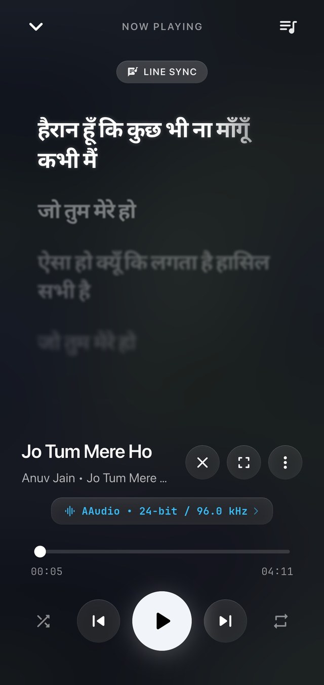

<div align="center">


# AcoustiQ

**Lossless FLAC forensic inspector, USB bit-perfect player & smart duplicate resolver for Android.**

<p>
  <a href="https://github.com/Clash-Projects/acoustiq/releases/latest">
    
  </a>
  <a href="https://github.com/Clash-Projects/acoustiq/blob/main/LICENSE">
    
  </a>
  
  
</p>

<p>
  <a href="https://github.com/Clash-Projects/acoustiq/releases/latest">
    
  </a>
  &nbsp;
  <a href="https://discord.gg/DmyM2p2fMe">
    
  </a>
</p>

<p>
  <a href="#screenshots">Screenshots</a> ·
  <a href="#features">Features</a> ·
  <a href="#download--install">Download</a> ·
  <a href="#build-from-source">Build from Source</a> ·
  <a href="#privacy--security">Privacy</a>
</p>

</div>

---

## Why AcoustiQ?

A `.flac` extension or `24-bit / 96 kHz` tag does not guarantee genuine lossless audio. Low-bitrate MP3 and AAC files transcoded into FLAC containers look identical in standard players and file managers.

AcoustiQ inspects every file **100% offline** on your device — combining binary `STREAMINFO` MD5 validation with Cooley-Tukey FFT & Welch PSD spectral roll-off analysis — paired with a native USB UAC1/UAC2 bit-perfect player, synced offline lyrics, and a smart duplicate resolver.

---

## Screenshots

<p align="center">
  
  &nbsp;
  
  &nbsp;
  
  &nbsp;
  
</p>

<p align="center">
  <em>Forensic Inspector · Spectrogram Dead-Zone · A/B Compare Matrix · 60fps Synced Lyrics</em>
</p>

<details>
<summary>📸 View More Screens (Library Audit, Duplicate Resolver, Comparison Sheet & Full Player)</summary>
<br />
<p align="center">
  
  &nbsp;
  
  &nbsp;
  
  &nbsp;
  
</p>
</details>

---

## Features

| Capability | Highlights |
| :--- | :--- |
| **🔬 Forensic Inspector** | Bilinear Inferno STFT spectrogram, Welch PSD cutoff detection (`16–22+ kHz`), instant MP3-to-FLAC upscale detection, and full bitstream telemetry |
| **🛡️ MD5 & Library Audit** | Batch scan across your music folders against embedded FLAC `STREAMINFO` MD5 to spot bit-rot or corrupted files, plus lossless cover art & `.lrc` export |
| **🎯 Smart Duplicate Resolver** | Multi-stage matching (MD5, normalized metadata, live/extended duration delta), AcoustiQ Pick ranking, mobile/tablet diff views & inline A/B preview |
| **⚡ Native Hi-Res & USB DAC** | `16`/`24`/`32`-bit & float PCM decoding (`NativeAudioEngine.kt`), direct kernel USB UAC1/UAC2 driver (`usbiso.c`), AAudio / OpenSL ES (`nativeout.c`) & honest Signal Path |
| **🎵 Player & Offline Lyrics** | Full-screen artwork blur player, swipeable MiniPlayer, and 60fps Word/Line-synced offline lyrics (`Default`, `Flow`, `Halo` styles, RTL support & `.lrc` export) |
| **✨ Glass, Matte & Themes** | Switch between WWDC25 frosted Liquid Glass and high-contrast opaque **Matte Mode**, 240 Hz Euler dock, 6 accents (including Monochrome) & Dark/Light/AMOLED |

---

## Download & Install

1. Download **`AcoustiQ-vX.Y.Z.apk`** (and optional `.sha256` checksum) from [**GitHub Releases**](https://github.com/Clash-Projects/acoustiq/releases/latest).
2. Install the signed APK on Android **8.0+** (API 26+) and grant storage access to scan your local library.
3. *(Optional)* Connect a UAC1/UAC2 USB DAC and tap the **Signal Path** badge in the player to monitor hardware pass-through status.

> **Upgrading from `v1.0.0`?** Starting with `v2.0.0`, AcoustiQ uses the signed `com.clashprojects.acoustiq` application ID, installing cleanly alongside legacy template builds.

---

## Build from Source

<details>
<summary>🛠️ Prerequisites, Build Commands, Release Signing & Architecture</summary>

### Prerequisites
- **Flutter** `3.50.0+` / **Dart** `3.14.0+`
- **Android SDK** (Compile 36 / Min 26 / Target 35) & **NDK** `28.2.13676358`
- **JDK** `17` / **Gradle** `9.3.1` (AGP `9.1.1`)

### Local Commands

```bash
git clone https://github.com/Clash-Projects/acoustiq.git
cd acoustiq
flutter pub get
flutter analyze --no-fatal-infos
flutter test
flutter build apk --release
```

### Wireless Deploy & Release Signing
- Run `./deploy.sh` after `adb connect <DEVICE_IP>:5555` for quick wireless installs.
- Add gitignored `android/key.properties` + `.jks` locally (or `ANDROID_KEYSTORE_*` GitHub Secrets) for release signing; Gradle falls back cleanly to debug signing when absent.

### Architecture Overview

```text
.github/workflows/build.yml        CI verify gate + signed releases
android/app/src/main/
├── cpp/
│   ├── usbiso.c                   Kernel USBFS UAC1/UAC2 driver
│   ├── nativeout.c                AAudio & OpenSL ES output
│   └── CMakeLists.txt             16 KB Android 15 page alignment
└── kotlin/com/clashprojects/acoustiq/
    ├── MainActivity.kt            Platform channels & fallback
    └── NativeAudioEngine.kt       PCM decoder & USB DAC bridge
lib/
├── main.dart                      App entry & channel bootstrap
├── models/                        AppSettings & FlacInfo models
├── screens/                       Inspect, Audit, Duplicates, Player
├── services/                      FLAC parser, FFT DSP, USB, Updater
├── utils/                         Synced/plain lyrics parser
└── widgets/                       Euler dock, lyrics, glass & matte
```

</details>

---

## Privacy & Security

All forensic inspection, spectral math, duplicate matching, lyrics parsing, and playback run **100% offline**. Audio data and hashes never leave your device. The only optional network request is user-initiated update checking against `api.github.com/repos/Clash-Projects/acoustiq`. Zero analytics, zero ads, zero telemetry.

## Community & Support

- **Discord**: [Join Clash Projects](https://discord.gg/DmyM2p2fMe)
- **Telegram**: [@clashprojects](https://t.me/clashprojects)
- **Issues**: [GitHub Issues](https://github.com/Clash-Projects/acoustiq/issues)

## License

Licensed under the **GNU General Public License v3.0** — see [LICENSE](LICENSE).

<div align="center">

---

Built with ❤️ by [Clash Projects](https://github.com/Clash-Projects)

</div>
